# System Architecture & Technical Diagrams — NEPL Box Cricket

This document contains visual diagrams, interaction models, data flows, and state machines modeling the **NEPL (Nyati Era Premier League)** platform.

---

## 1. System Context Diagram (C4 Level 1)


<b>View Mermaid Source</b>

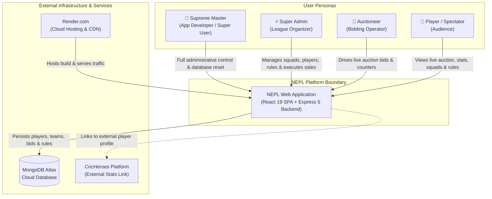

---

## 2. Container Architecture Diagram (C4 Level 2)


<b>View Mermaid Source</b>

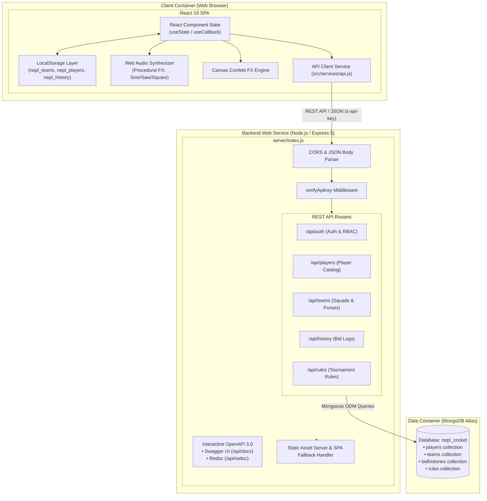

---

## 3. Component Architecture Diagram (C4 Level 3)

### 3.1 Frontend Component Architecture (`src/`)


<b>View Mermaid Source</b>

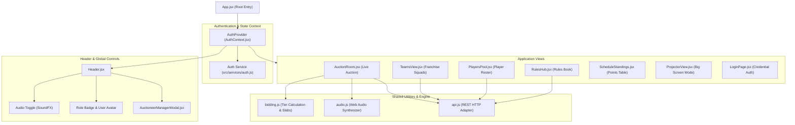

---

## 4. Entity Relationship Diagram (ERD)


<b>View Mermaid Source</b>

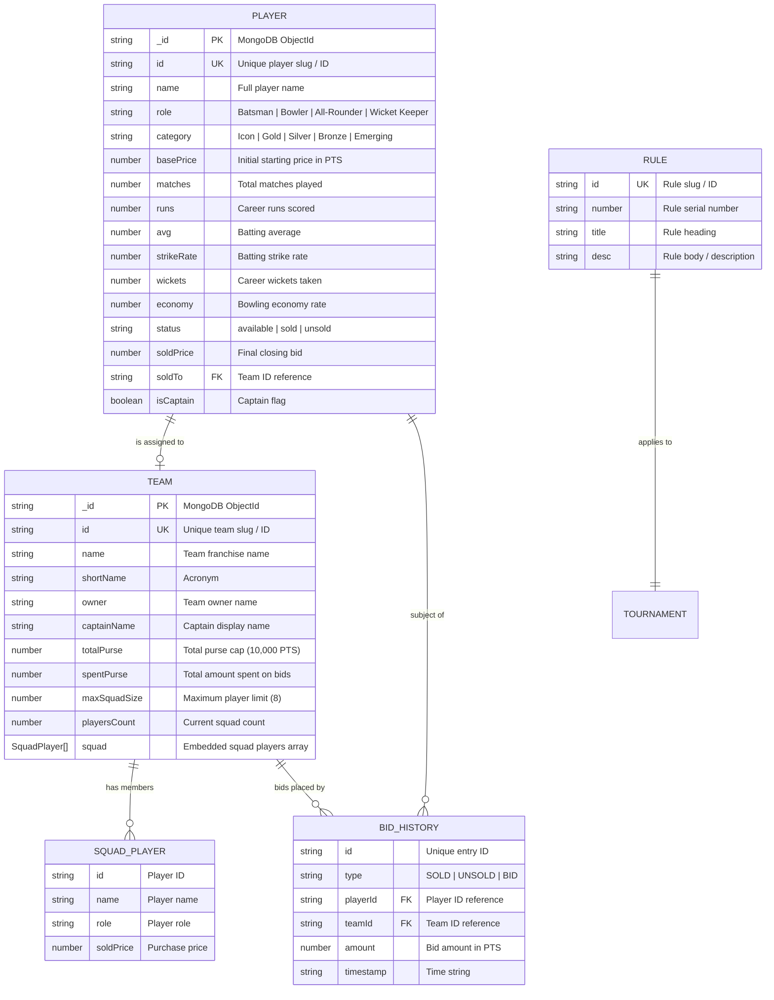

---

## 5. State Machine Diagrams

### 5.1 Player Auction Lifecycle State Machine


<b>View Mermaid Source</b>

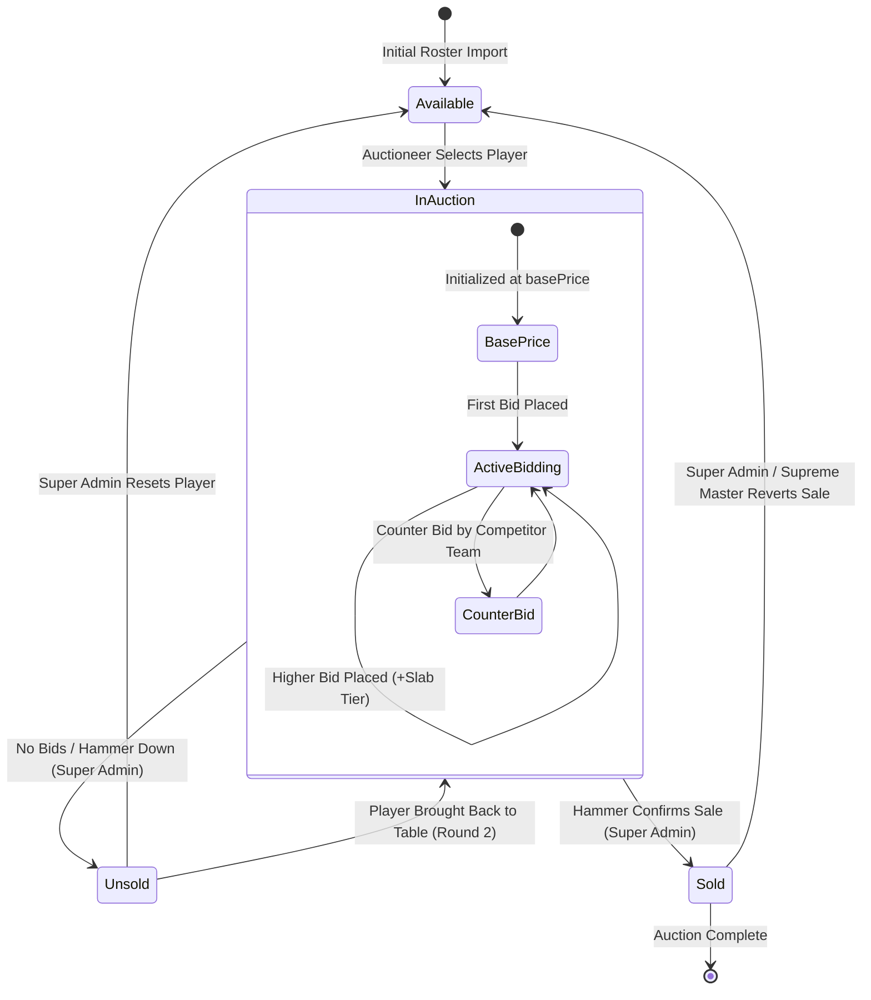

---

## 6. Sequence Diagrams

### 6.1 Authentication & Session Flow

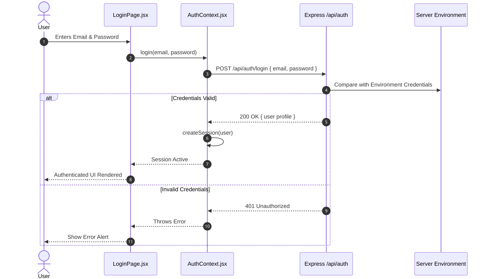

<b>View Mermaid Source</b>

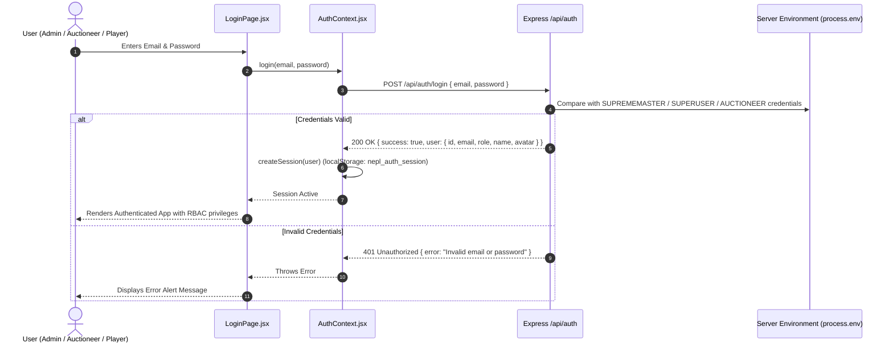

### 6.2 Live Bid Placement & Dynamic Slab Validation

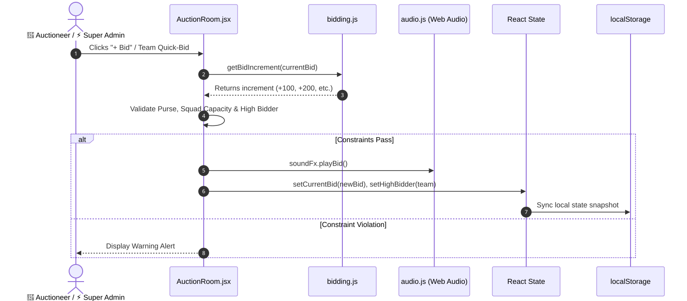

<b>View Mermaid Source</b>

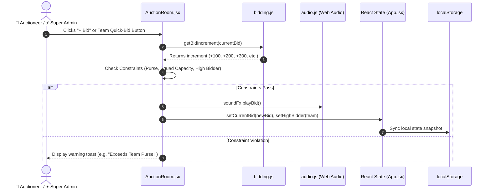

### 6.3 Player SOLD Hammer Down & Squad Assignment

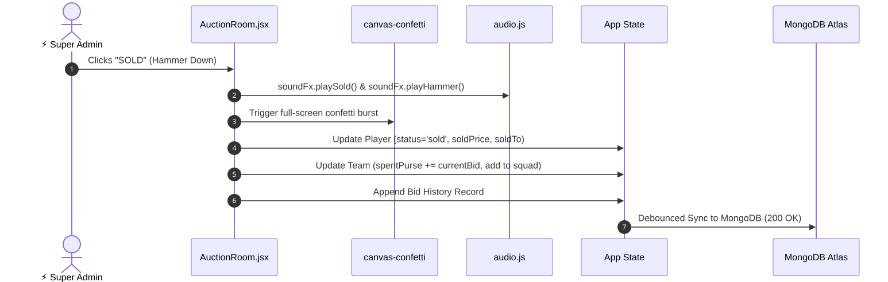

<b>View Mermaid Source</b>

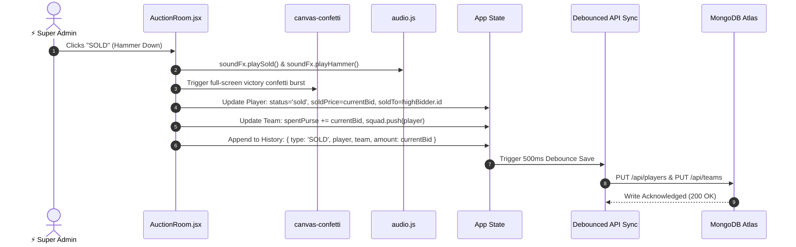

---

## 7. Deployment Topology & Network Architecture


<b>View Mermaid Source</b>

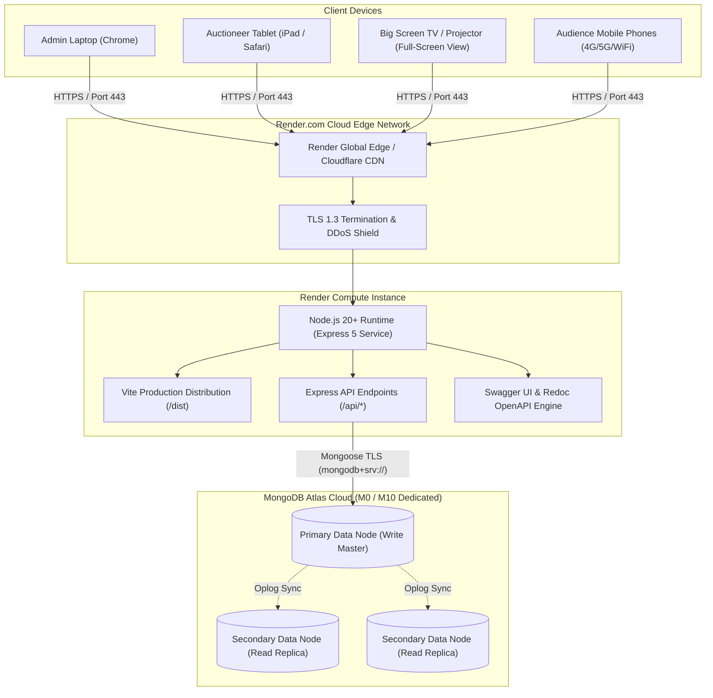

