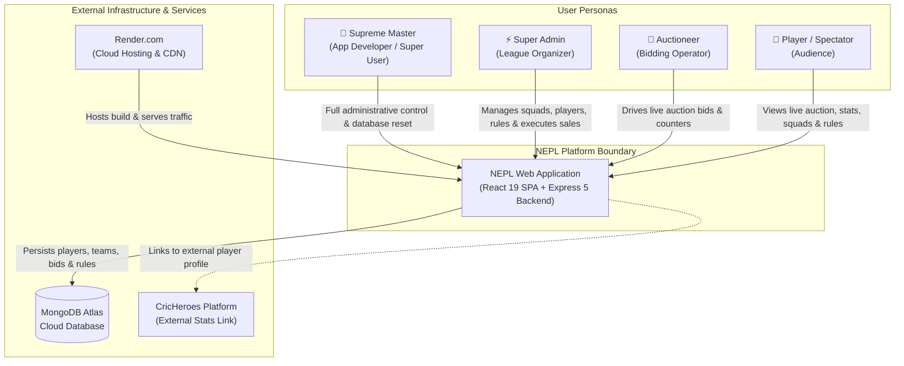
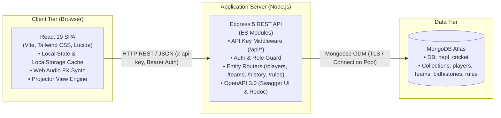
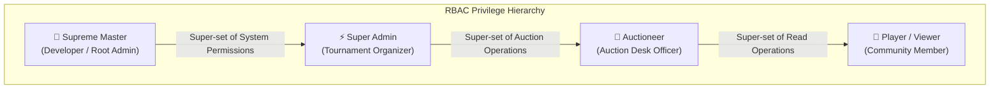
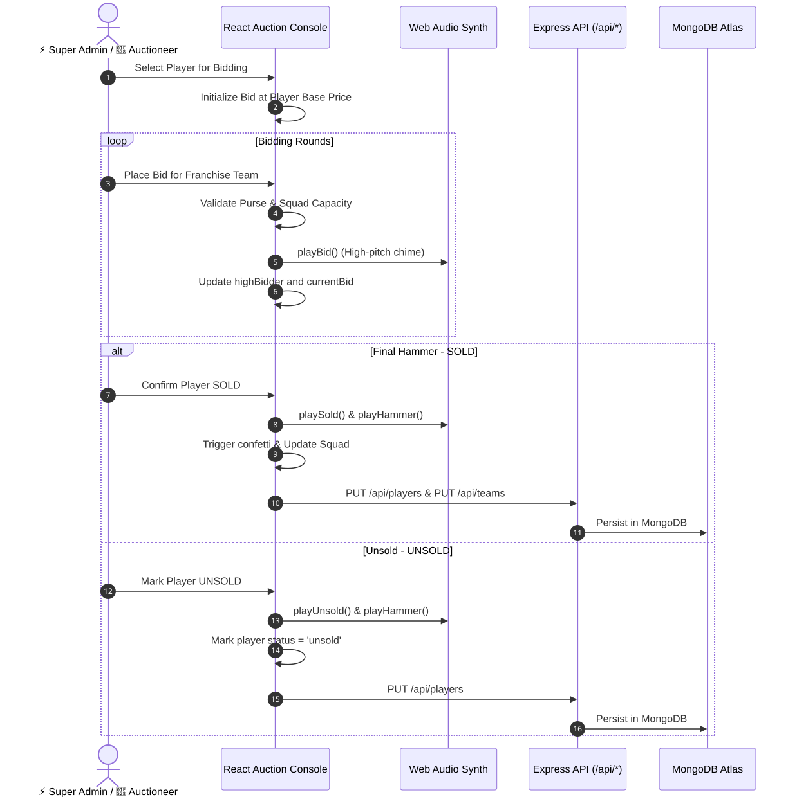
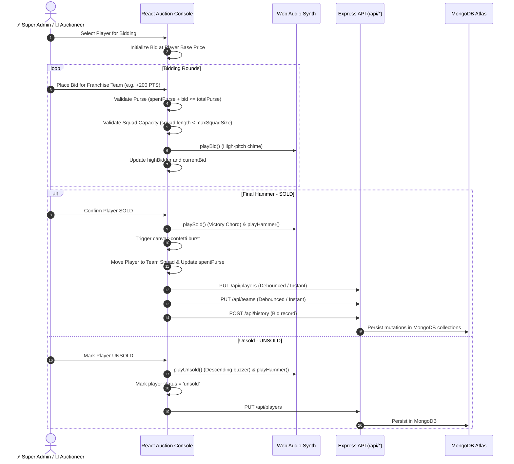
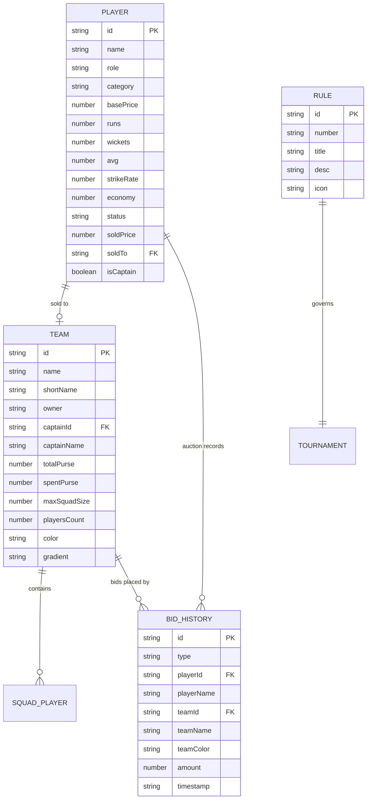
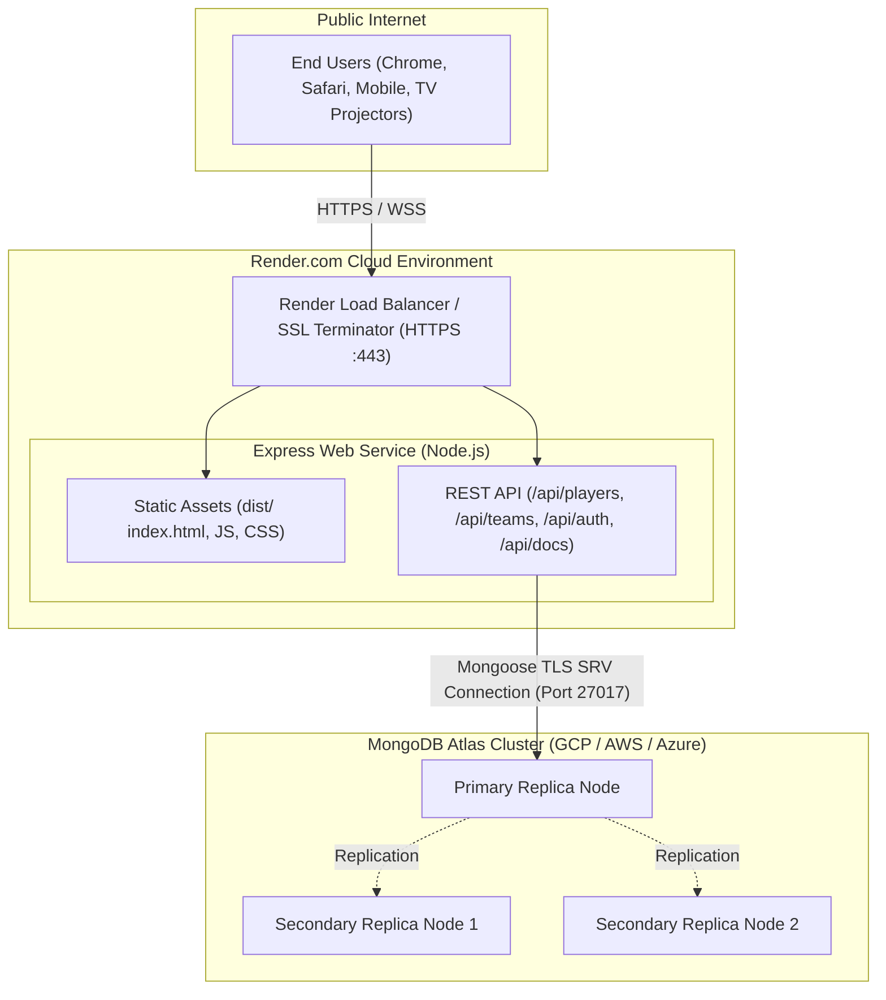

# High-Level Design (HLD) — NEPL Box Cricket Platform

## 1. Executive Summary & Objectives

The **Nyati Era Premier League (NEPL)** application is an auction and league operations platform designed for managing box cricket tournaments. It provides a real-time, responsive interface for auctioneers, franchise owners, team captains, players, and spectators to participate in and view live player bidding, team budget allocations, player profile evaluations, tournament standings, and tournament regulations.

### Key Objectives
1. **Zero-Latency Live Auction:** Provide an interactive bidding console with automatic budget enforcement, dynamic bid increment tiers, and immediate visual/audio feedback.
2. **Multi-Role Governance:** Strict role segregation ensuring only authorized personnel (Auctioneer, Super Admin, Supreme Master) can alter state, while players and spectators enjoy read-only transparency.
3. **High-Impact Presentation:** Dedicated "Projector / TV Mode" allowing live streaming/casting onto large screens during the auction gala.
4. **Resilient Data Architecture:** Seamless dual-persistence ensuring zero data loss during network hiccups using local client-side state combined with debounced synchronization to cloud-hosted MongoDB Atlas.

---

## 2. System Context (C4 Model — Level 1)

The system context diagram illustrates how different user personas and external services interact with the NEPL platform.

<b>View Mermaid Source</b>

---

## 3. Container Architecture (C4 Model — Level 2)

The system is architected as a lightweight, modern full-stack application comprising a single-page frontend, a stateless REST API layer, and a cloud document store.

<b>View Mermaid Source</b>

---

## 4. Architectural Patterns & Principles

1. **Layered Decoupled Architecture:** Separation of Presentation (React SPA), API & Orchestration (Express.js), and Persistence (MongoDB + Mongoose).
2. **Optimistic UI with Background Reconciliation:** User actions (bids, sold marks) immediately update the local React state and `localStorage` to eliminate perceived UI lag, while asynchronous debounced HTTP requests commit the changes to MongoDB.
3. **Stateless API Gateway Pattern:** Express server maintains zero in-memory session state, allowing seamless scaling and server restarts without interrupting client interactions.
4. **Environment-Driven Configuration & Defense-in-Depth:** Credentials, MongoDB URIs, and API keys are strictly configured via environment variables. Mutating REST API endpoints are guarded by `verifyApiKey` middleware.
5. **No External Asset Dependency for Audio:** Audio synthesis utilizes the browser's native **Web Audio API** (`AudioContext`, `OscillatorNode`, `GainNode`) rather than external MP3/WAV files, ensuring offline reliability and zero loading latency.

---

## 5. Role-Based Access Control (RBAC) Architecture

The platform implements a fine-grained 4-tier RBAC system:

<b>View Mermaid Source</b>

### Role Permissions Matrix

| Permission Key | Supreme Master (`suprememaster`) | Super Admin (`superuser`) | Auctioneer (`auctioneer`) | Player (`player`) |
|---|:---:|:---:|:---:|:---:|
| `canViewAuction` | ✅ | ✅ | ✅ | ✅ |
| `canViewTeams` | ✅ | ✅ | ✅ | ✅ |
| `canViewPlayers` | ✅ | ✅ | ✅ | ✅ |
| `canViewRules` | ✅ | ✅ | ✅ | ✅ |
| `canViewSchedule` | ✅ | ✅ | ✅ | ✅ |
| `canAccessProjector` | ✅ | ✅ | ✅ | ✅ |
| `canBid` | ❌ *(Audit mode)* | ✅ | ✅ | ❌ |
| `canSellPlayer` | ❌ | ✅ | ❌ *(Escalate to Admin)* | ❌ |
| `canUnsellPlayer` | ❌ | ✅ | ❌ | ❌ |
| `canOverrideBid` | ❌ | ✅ | ❌ | ❌ |
| `canEditPlayers` | ❌ | ✅ | ❌ | ❌ |
| `canAddPlayers` | ❌ | ✅ | ❌ | ❌ |
| `canDeletePlayers` | ❌ | ✅ | ❌ | ❌ |
| `canManageTeams` | ❌ | ✅ | ❌ | ❌ |
| `canManageUsers` | ✅ | ✅ | ❌ | ❌ |
| `canResetData` | ✅ *(Exclusive)* | ❌ | ❌ | ❌ |

---

## 6. Core Business Workflows

### 6.1 Live Auction Lifecycle

<b>View Mermaid Source</b>

### 6.2 Bidding Increment Slabs (Dynamic Engine)

The system automatically scales the mandatory bid step based on the current bid value to accelerate auction velocity while maintaining fairness:

| Current Bid Range (PTS) | Minimum Increment | Tier Label |
|---|---|---|
| **0 – 999** | **+100 PTS** | Tier 1 (Base) |
| **1,000 – 2,999** | **+200 PTS** | Tier 2 (Mid) |
| **3,000 – 4,999** | **+300 PTS** | Tier 3 (High) |
| **5,000 – 6,999** | **+400 PTS** | Tier 4 (Premium) |
| **≥ 7,000** | **+100 PTS per 2,000 PTS slab** | Tier N (Elite) |

---

## 7. Data Architecture & Schema Overview

The database contains 4 primary collections inside the `nepl_cricket` database:

<b>View Mermaid Source</b>

---

## 8. Deployment & Network Topology

The production setup uses **Render.com** and **MongoDB Atlas Cloud**:

<b>View Mermaid Source</b>

---

## 9. Non-Functional Requirements (NFRs)

| Metric / Dimension | Target / Strategy | Implementation Details |
|---|---|---|
| **Latency & Responsiveness** | < 50ms UI update | Optimistic state update in React; background debounced MongoDB persistence (500ms delay). |
| **Availability** | 99.9% uptime | Hosted on Render auto-restarting Web Services backed by multi-AZ MongoDB Atlas replica set. |
| **Security** | Zero credential leak | Authentication verification executed on server; passwords never included in client bundle. Mutating routes guarded by `x-api-key`. |
| **Offline Resilience** | Full offline auction continuity | State automatically synchronized to `localStorage`. If server or internet disconnects, auction continues uninterrupted. |
| **Compatibility** | All modern browsers & TV WebViews | Responsive Tailwind CSS layouts, full support for Desktop, Tablet, Mobile, and Big-Screen Projectors. |
| **Developer Ergonomics** | Self-documenting API | Interactive Swagger UI (`/api/docs`) and Redoc 3-column viewer (`/api/redoc`) generated directly from OpenAPI 3.0 specification. |
