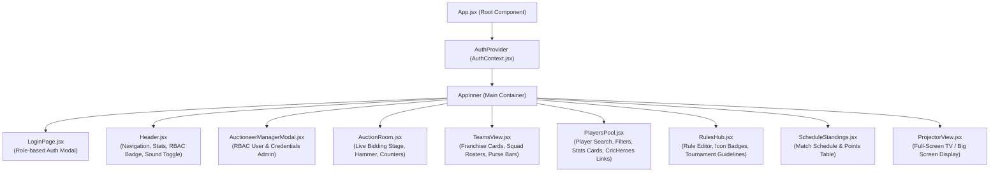
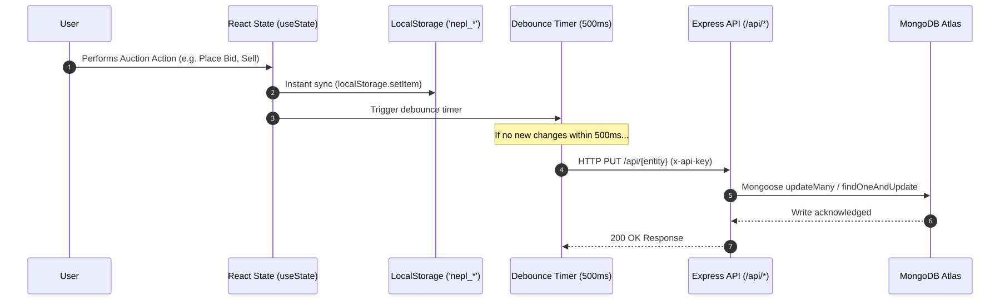
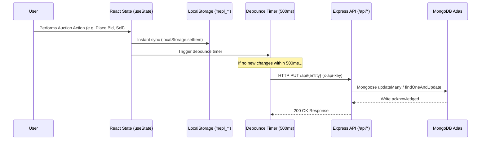
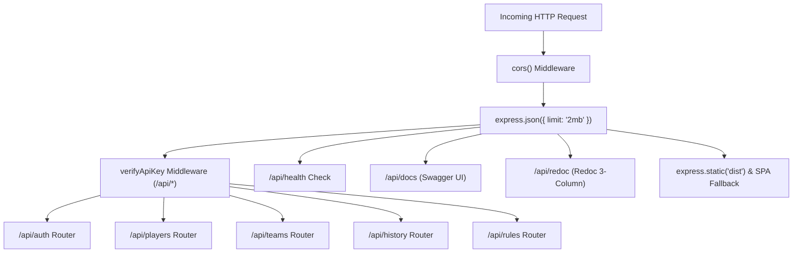
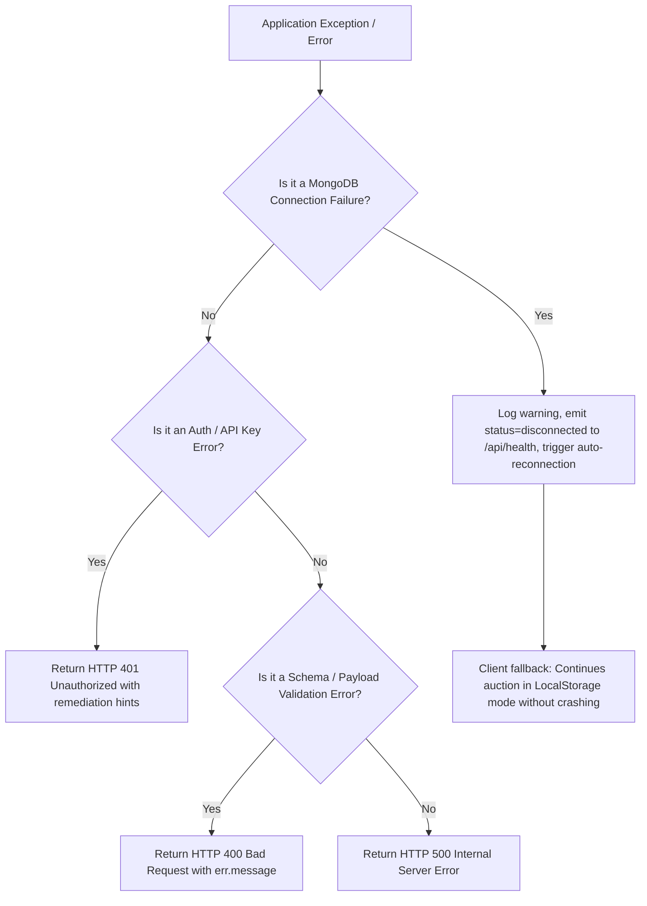

# Low-Level Design (LLD) — NEPL Box Cricket Platform

## 1. System Architecture & Module Breakdown

The NEPL application codebase is divided into two primary subsystems:
1. **Client Subsystem (`src/`):** React 19 Single Page Application bundled with Vite 5.
2. **Server Subsystem (`server/`):** Express 5 REST API service with Mongoose ODM connected to MongoDB Atlas.

---

## 2. Frontend Subsystem Specifications

### 2.1 React Component Hierarchy



<details>
<summary><b>View Mermaid Source</b></summary>


</details>

---

### 2.2 Frontend State & Lifecycle Management

The root state resides in `App.jsx` and is passed down as props to child views.

```typescript
interface AppState {
  activeTab: 'auction' | 'teams' | 'players' | 'rules' | 'schedule';
  isProjectorMode: boolean;
  soundEnabled: boolean;
  isLoading: boolean;
  isDbConnected: boolean;
  players: Player[];
  teams: Team[];
  history: BidHistoryEntry[];
  rules: TournamentRule[];
}
```

#### Dual-Layer Synchronization Pipeline



<details>
<summary><b>View Mermaid Source</b></summary>


</details>

---

### 2.3 Web Audio FX Synthesizer Engine (`src/utils/audio.js`)

NEPL features a pure Web Audio API synthesizer that generates procedural sound effects with zero external audio assets.

```javascript
class SoundFX {
  constructor() {
    this.ctx = null;
    this.enabled = true;
  }
  init() { /* Instantiates AudioContext on first user gesture */ }
  playBid() { /* Sine wave: 587.33Hz (D5) -> 880Hz (A5) in 150ms */ }
  playSold() { /* Triad chord: C5 (523Hz), E5 (659Hz), G5 (784Hz), C6 (1046Hz) */ }
  playUnsold() { /* Sawtooth descending buzzer: 220Hz (A3) -> 110Hz (A2) in 400ms */ }
  playHammer() { /* Square wave percussive thud: 150Hz -> 30Hz in 100ms */ }
}
```

---

### 2.4 Bidding Engine & Tier Calculation (`src/utils/bidding.js`)

The bidding engine calculates minimum allowable bid steps dynamically using a piecewise mathematical step function:

$$\text{Increment}(B) = \begin{cases} 
100 & \text{if } B < 1000 \\
200 + \left\lfloor \frac{B - 1000}{2000} \right\rfloor \times 100 & \text{if } B \ge 1000 
\end{cases}$$

#### Implementation:
```javascript
export function getBidIncrement(currentBid) {
  const bid = Math.max(0, Number(currentBid) || 0);
  if (bid < 1000) return 100;
  return 200 + Math.floor((bid - 1000) / 2000) * 100;
}

export function getBidSlabInfo(currentBid) {
  const bid = Math.max(0, Number(currentBid) || 0);
  const increment = getBidIncrement(bid);
  // Calculates tier label, range text and minimum next bid
  return { increment, label, rangeText, minNextBid: bid + increment };
}
```

#### Team Purse & Squad Capacity Validation Rules:
1. **Purse Constraint:** A team can only place a bid $B$ if:
   $$\text{spentPurse} + B \le \text{totalPurse}$$
2. **Squad Capacity Constraint:** A team cannot bid if:
   $$\text{squad.length} \ge \text{maxSquadSize}$$
3. **Turn Constraint:** A team currently holding the highest bid cannot place an incremental bid against itself.

---

## 3. Backend Subsystem Specifications

### 3.1 Express Server Initialization & Pipeline (`server/index.js`)



<details>
<summary><b>View Mermaid Source</b></summary>


</details>

---

### 3.2 Security & Authentication Middleware (`server/middleware/authApiKey.js`)

Mutating API operations (POST, PUT, DELETE) are guarded by API Key validation:

```javascript
export function verifyApiKey(req, res, next) {
  // Publicly allowed paths:
  if (
    req.method === 'GET' || 
    req.path.startsWith('/docs') || 
    req.path === '/openapi.json' || 
    req.path === '/health' ||
    req.path.startsWith('/auth')
  ) {
    return next();
  }

  const validKeys = new Set([
    process.env.API_KEY,
    process.env.VITE_API_KEY,
  ].filter(Boolean));

  const apiKey = req.headers['x-api-key'] || req.headers['authorization']?.replace('Bearer ', '');

  if (apiKey && validKeys.has(apiKey)) return next();
  if (validKeys.size === 0) return next(); // Local Dev Mode fallback

  return res.status(401).json({
    error: 'Unauthorized: Valid API key required in x-api-key header to modify data'
  });
}
```

---

## 4. Database Schema Specifications (Mongoose Models)

### 4.1 Player Model (`server/models/Player.js`)

```javascript
const PlayerSchema = new mongoose.Schema({
  id: { type: String, required: true, unique: true },
  name: { type: String, required: true },
  role: { type: String, enum: ['Batsman', 'Bowler', 'All-Rounder', 'Wicket Keeper'] },
  category: { type: String, enum: ['Icon', 'Gold', 'Silver', 'Bronze', 'Emerging'] },
  basePrice: { type: Number, default: 500 },
  matches: { type: Number, default: 0 },
  runs: { type: Number, default: 0 },
  avg: { type: Number, default: 0 },
  strikeRate: { type: Number, default: 0 },
  wickets: { type: Number, default: 0 },
  economy: { type: Number, default: 0 },
  bestBowling: { type: String, default: '-' },
  cricHeroesUrl: { type: String, default: '' },
  avatarUrl: { type: String, default: '' },
  status: { type: String, enum: ['available', 'sold', 'unsold'], default: 'available' },
  soldPrice: { type: Number, default: 0 },
  soldTo: { type: String, default: null }, // Team ID
  isCaptain: { type: Boolean, default: false },
  isAuctioneer: { type: Boolean, default: false },
  captainOfTeamId: { type: String, default: null },
}, { timestamps: true });
```

### 4.2 Team Model (`server/models/Team.js`)

```javascript
const SquadPlayerSchema = new mongoose.Schema({
  id: String,
  name: String,
  role: String,
  category: String,
  soldPrice: Number,
  avatarUrl: String,
  cricHeroesUrl: String,
  isCaptain: { type: Boolean, default: false },
  isAuctioneer: { type: Boolean, default: false },
}, { _id: false });

const TeamSchema = new mongoose.Schema({
  id: { type: String, required: true, unique: true },
  name: { type: String, required: true },
  shortName: { type: String, required: true },
  owner: { type: String, default: '' },
  captainId: { type: String, default: null },
  captainName: { type: String, default: null },
  color: { type: String, default: '#06b6d4' },
  gradient: { type: String, default: 'from-cyan-600 to-blue-700' },
  borderColor: { type: String, default: 'border-cyan-500' },
  bgBadge: { type: String, default: 'bg-cyan-500/20 text-cyan-300' },
  totalPurse: { type: Number, default: 10000 },
  spentPurse: { type: Number, default: 0 },
  maxSquadSize: { type: Number, default: 8 },
  playersCount: { type: Number, default: 0 },
  logo: { type: String, default: '' },
  squad: [SquadPlayerSchema],
}, { timestamps: true });
```

### 4.3 Bid History Model (`server/models/BidHistory.js`)

```javascript
const BidHistorySchema = new mongoose.Schema({
  id: { type: String, required: true },
  type: { type: String, enum: ['SOLD', 'UNSOLD', 'BID'], default: 'BID' },
  playerId: { type: String, required: true },
  playerName: { type: String, required: true },
  teamId: { type: String, default: null },
  teamName: { type: String, default: null },
  teamColor: { type: String, default: null },
  amount: { type: Number, default: 0 },
  timestamp: { type: String, required: true },
}, { timestamps: true });
```

### 4.4 Tournament Rule Model (`server/models/Rule.js`)

```javascript
const RuleSchema = new mongoose.Schema({
  id: { type: String, required: true, unique: true },
  number: { type: String, required: true },
  title: { type: String, required: true },
  desc: { type: String, required: true },
  icon: { type: String, default: 'BookOpen' },
}, { timestamps: true });
```

---

## 5. REST API Interface Contracts

| Method | Route | Description | Auth Required | Request Body / Query | Success Response |
|---|---|---|---|---|---|
| `GET` | `/api/health` | Service & DB Health Check | None | None | `{ status: "ok", db: "connected", dbState: 1 }` |
| `POST` | `/api/auth/login` | Validate user credentials | None | `{ email, password }` | `{ success: true, user: SafeUser }` |
| `GET` | `/api/auth/users` | List user profiles | None | None | `Array<SafeUser>` |
| `GET` | `/api/players` | Fetch all players | None | None | `Array<Player>` |
| `POST` | `/api/players` | Create player | API Key | `Player` | `Player` (201 Created) |
| `PUT` | `/api/players` | Bulk replace players | API Key | `Array<Player>` | `{ success: true, count: N }` |
| `PUT` | `/api/players/:id` | Update single player | API Key | `Partial<Player>` | `Player` (200 OK) |
| `DELETE`| `/api/players/:id` | Delete player | API Key | None | `{ success: true }` |
| `GET` | `/api/teams` | Fetch all teams | None | None | `Array<Team>` |
| `PUT` | `/api/teams` | Bulk replace teams | API Key | `Array<Team>` | `{ success: true, count: N }` |
| `PUT` | `/api/teams/:id` | Update single team | API Key | `Partial<Team>` | `Team` (200 OK) |
| `DELETE`| `/api/teams/:id` | Delete team | API Key | None | `{ success: true }` |
| `GET` | `/api/history` | Fetch bid logs (latest 500) | None | None | `Array<BidHistoryEntry>` |
| `POST` | `/api/history` | Log bid entry | API Key | `BidHistoryEntry` | `BidHistoryEntry` (201 Created) |
| `PUT` | `/api/history` | Bulk replace history | API Key | `Array<BidHistoryEntry>` | `{ success: true, count: N }` |
| `GET` | `/api/rules` | Fetch tournament rules | None | None | `Array<Rule>` |
| `PUT` | `/api/rules` | Bulk replace rules | API Key | `Array<Rule>` | `{ success: true, count: N }` |
| `PUT` | `/api/rules/:id` | Update single rule | API Key | `Partial<Rule>` | `Rule` (200 OK) |
| `DELETE`| `/api/rules/:id` | Delete rule | API Key | None | `{ success: true }` |

---

## 6. Error Handling & Resilience Matrix



<details>
<summary><b>View Mermaid Source</b></summary>


</details>
